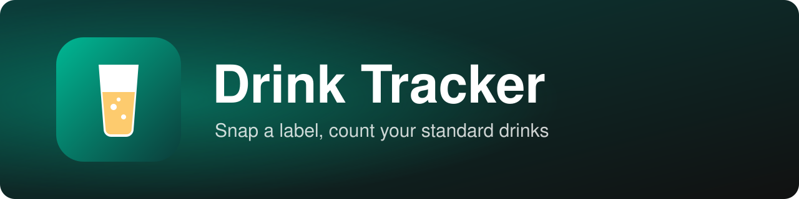

<p align="center"></p>

Take a photo of a drink label and the app reads it with OCR, pulls out the ABV and volume, and works out Australian standard drinks (1 standard = 10 g of alcohol). Keep a log for the night with a running total and an estimated BAC curve.

## Features

- Camera or photo upload, read with Tesseract.js OCR
- Detects ABV, volume (incl. "24 x 375mL") and printed "X STANDARD DRINKS"
- Always lets you confirm or correct; manual entry and 12 Australian presets
- Night log with times, running total, edit/delete and history
- Widmark BAC estimate with peak and time back to zero

## Running it

Plain HTML, CSS and JavaScript with no build step. Serve the folder (the live camera needs HTTPS or localhost):

```bash
python -m http.server 8000
```

Run the parser tests with `node test-parse.js`.

## Limitations

- **The BAC figure is an estimate only. Never use it to decide whether to drive.**
- OCR struggles with curved or shiny cans, so check the values
- OCR library downloads on first use (needs internet)
