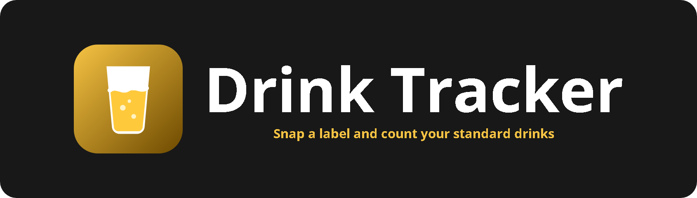
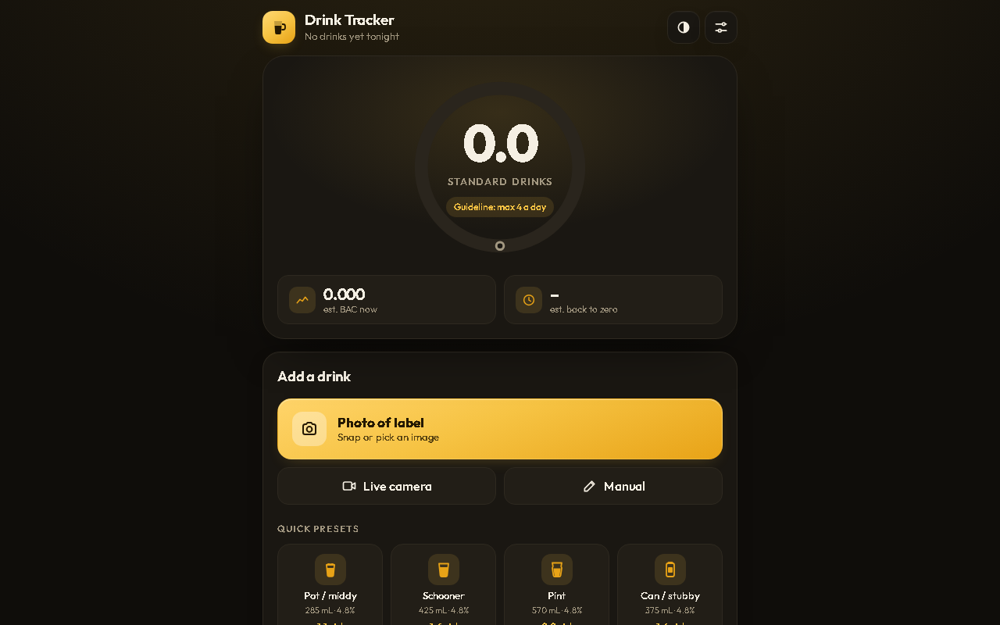

<p align="center"></p>

<p align="center">    </p>

Take a photo of a drink label and Drink Tracker reads it with OCR, picks out the ABV and volume, and works out how many Australian standard drinks it is (1 standard drink = 10 g of alcohol). Keep a log for the night with a running total and an estimated blood alcohol curve.

<p align="center"></p>

## Features

- Camera capture or photo upload, read on-device with Tesseract.js
- Detects ABV, volume (mL, cL, L and multipacks like "24 x 375mL") and printed "X STANDARD DRINKS"
- You always confirm or correct the values; manual entry and 12 Australian presets (schooner, pint, pot, wine glass, shot and more)
- Night log with times, running total, edit and delete, and history
- Widmark BAC estimate chart with peak and time back to zero

## Getting started

No build step and no dependencies. Clone the repo and open `index.html`, or serve the folder locally:

```bash
git clone https://github.com/Squidly1408/drink-tracker.git
cd drink-tracker
python -m http.server 8000
```

Then visit http://localhost:8000.

The live camera needs HTTPS or `localhost`. Run the parser tests with:

```bash
node test-parse.js
```

## Project structure

| File | Purpose |
|---|---|
| `index.html` | App shell |
| `app.js` | UI, camera, log and chart |
| `parse.js` | Label parsing and BAC maths |
| `test-parse.js` | Parser tests (`node test-parse.js`) |
| `styles.css` | Styles |
| `assets/` | Logo and README images |

## Built with

HTML, CSS, JavaScript, [Tesseract.js](https://tesseract.projectnaptha.com/), localStorage

## Limitations

- **The BAC figure is a rough estimate only. Never use it to decide whether you are safe to drive.**
- OCR struggles with curved or shiny cans, so always check the values
- The OCR engine downloads on first use (needs internet)

## License

Released under the [MIT License](LICENSE).
